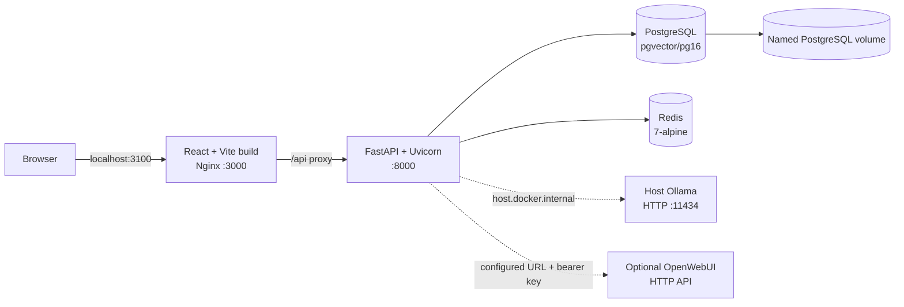

# CyberSec Career Intelligence

CyberSec Career Intelligence is a competency intelligence platform for analyzing cybersecurity job descriptions and consolidating the expected knowledge, skills, responsibilities, and evidence across security domains and career levels.

It is **not** a job board, job tracker, job aggregator, applicant-tracking system, or company-research platform. The application turns research inputs into reviewable, taxonomy-aware competency expectations.

> **Development status:** Phases 1–5 are implemented. The seeded competency and expectation records are explicitly illustrative development data, not verified market research.

## Features

### Knowledge base and exploration

- Hierarchical cybersecurity competency taxonomy with eight top-level domains (including governance, risk, and compliance; identity and access management; and security operations) and embedded-security subdomains.
- Six seeded career levels with explicit shared, technical, and management tracks.
- Reusable competency definitions, categories, relationships, and domain/level expectations.
- Supporting research-source references and bounded evidence excerpts.
- Domain Explorer with subdomain navigation, career-level filtering, categories, expectations, and evidence.
- Career Matrix showing expectation and competency coverage by domain and career level.
- Career Comparison for differences and shared competencies across selected levels.
- Competency Explorer with search, filters, relationships, and expectation detail.
- Global Search across domains, competencies, and expectations.
- Retained Phase 1 profile creation and listing for a lightweight personal baseline.

### Research consolidation

- Administrator-only submission of pasted text and UTF-8 `.txt`, `.json`, or `.csv` files.
- Server-side URL import with editable preview before any AI analysis.
- URL safety controls including HTTP(S)-only input, redirect limits, response-size limits, timeout limits, public-address validation, and bounded HTML/JSON-LD extraction.
- Taxonomy-aware extraction of competencies, domains, career levels, categories, evidence, confidence, and responsibilities.
- Duplicate-input detection using a SHA-256 content digest.
- Reviewable draft expectations with edit, approve, reject, and publish workflow.
- Research Admin submission history shows title, submitted date, processing status, review status, and a protected Delete action.
- Deletion requires administrator authentication and confirmation; failed, rejected, and approved-but-unpublished submissions can be removed with their unpublished findings, drafts, evidence links, and review decisions.
- Deletion is blocked while processing and whenever published expectations, published changes, or published batches depend on the submission; shared taxonomy and published knowledge are preserved.
- Only explicitly published expectations are visible through the public knowledge-base APIs.

### AI providers and model management

- Existing host Ollama integration using the native `/api/generate` contract.
- Optional OpenWebUI integration using authenticated OpenAI-compatible chat completions.
- Provider-specific model discovery and availability reporting.
- Administrator selection of the active provider and exact model ID.
- Connectivity testing without exposing provider credentials to the frontend.
- Small versioned model-evaluation benchmark with extraction, domain, career-level, JSON-validity, hallucination, latency, and overall metrics.
- Provider/model traceability on research submissions and evaluation records.
- Legacy Ollama routes remain available for existing clients.

### Operations and safety

- React frontend served by Nginx.
- FastAPI backend with OpenAPI documentation, request IDs, structured request logging, and configurable request-size limits.
- PostgreSQL persistence with Alembic migrations and startup migration handling for legacy Phase 1–5 schemas.
- Redis connectivity health reporting.
- Docker Compose health checks and isolated project network/volume names.
- No Ollama service is created by this project; the configured host Ollama instance is reused.

## Security domains

The seeded hierarchy is:

- **Web Application Security**
- **Cloud API Security**
- **Cloud Infrastructure Security**
- **Traditional Server Infrastructure Security**
- **Embedded Systems Security**
  - Embedded Application Security
  - Operating System Security
  - Boot Security
  - Hardware Security
  - Wireless Security

Domains are stored hierarchically, so additional domains or subdomains can be added through the administrative API without changing the database schema.

## Career levels and tracks

The seeded levels are:

- Junior — shared track
- Intermediate — shared track
- Senior — shared track
- Manager — management track
- Architect — technical track
- Director — management track

Technical and management career paths are deliberately distinct. Junior, Intermediate, and Senior are shared levels; Architect is technical; Manager and Director are management. The data model does not impose a single hierarchy between the two tracks.

## Architecture

The application runs as four project-owned Compose services and connects to AI providers outside the Compose application stack when configured:



### Runtime components

| Component | Implementation | Responsibility |
| --- | --- | --- |
| Frontend | React, Vite, Nginx | Knowledge-base exploration and administrator research console. |
| Backend | FastAPI, Uvicorn, SQLAlchemy | REST API, validation, research workflow, provider orchestration, and migrations. |
| Database | `pgvector/pgvector:pg16` | Taxonomy, competencies, expectations, sources, research submissions, drafts, and model selections/evaluations. |
| Redis | `redis:7-alpine` | Connectivity/readiness integration. The current application does not implement a Redis queue or cache worker. |
| Ollama | Host-managed external service | Optional local inference provider. It is not a Compose service in this project. |
| OpenWebUI | Optional external/provider endpoint | Optional authenticated inference and model-discovery provider. It may proxy local Ollama models or external services. |
| Compose | Docker Compose | Isolated project network, PostgreSQL volume, service dependencies, and health checks. |

The backend entrypoint applies Alembic migrations before starting Uvicorn. On startup, the application also ensures reference seed data exists. Existing legacy schema handling is intentionally retained for this project’s earlier phases.

## Technology stack and dependencies

Versions below are declared by the repository; they are not inferred or substituted versions.

### Backend

- Python `3.13-slim` container base image.
- FastAPI `0.115.6`.
- Uvicorn `[standard]` `0.34.0`.
- Pydantic Settings `2.7.1`.
- SQLAlchemy `2.0.36`.
- Psycopg binary `3.2.3`.
- Redis Python client `5.2.1`.
- HTTPX `0.28.1`.
- Python Multipart `0.0.20`.
- BeautifulSoup4 `4.13.4`.
- Alembic `1.14.0`.
- Pytest `8.3.4`.

The exact backend dependency pins are in [`backend/requirements.txt`](backend/requirements.txt).

### Frontend

- Node `22-alpine` build image.
- React `19.0.0` and React DOM `19.0.0`.
- Vite `6.0.7`.
- `@vitejs/plugin-react` `4.3.4`.
- Vitest `2.1.8`.
- Testing Library React `16.1.0`.
- JSDOM `25.0.1`.

The exact frontend dependency lockfile is [`frontend/package-lock.json`](frontend/package-lock.json), with direct dependencies declared in [`frontend/package.json`](frontend/package.json).

### Infrastructure images

- Backend: `python:3.13-slim`.
- Frontend build: `node:22-alpine`.
- Frontend runtime: `nginx:1.27-alpine`.
- Database: `pgvector/pgvector:pg16`.
- Redis: `redis:7-alpine`.

## System requirements

### Minimum requirements

The following are separated between repository-verified facts and practical estimates.

**Verified by this repository:**

- Docker Compose configuration resolves successfully with the required `.env` values.
- The project defines four services: `backend`, `frontend`, `postgres`, and `redis`.
- The backend and frontend Dockerfiles define health checks.
- PostgreSQL and Redis have Compose health checks; backend startup waits for both healthy dependencies, and frontend startup waits for the backend health check.
- The Compose stack uses project-specific network and volume names: `cybersec-career-intelligence-network` and `cybersec-career-intelligence-postgres-data`.

**Expected host support (not a complete compatibility matrix):**

- Linux with Docker Engine or Docker Desktop.
- macOS with Docker Desktop.
- Windows with Docker Desktop, preferably using the WSL2 backend.

**Practical estimates:**

- CPU: 2 vCPUs for the application stack; 4 or more is recommended for comfortable local development.
- RAM: approximately 4 GB for the database, Redis, backend, frontend, and build processes. AI model memory is additional and depends on the model.
- Disk: approximately 5 GB for images, dependencies, and the project database, plus additional space for Docker caches and any host AI models.
- Network: outbound access is needed to pull Docker images and npm/Python dependencies. Reachability to the selected AI provider is required for extraction, model tests, and evaluations.

These CPU, RAM, and disk figures are estimates, not enforced limits. Large local models can require substantially more memory than the application stack itself.

### AI requirements

AI extraction requires at least one configured and reachable provider with a usable model. The read-only knowledge-base pages, health API, and seeded database can run without an AI provider, but research submission analysis cannot complete without one.

- **Ollama:** configure `OLLAMA_BASE_URL` and `OLLAMA_MODEL`. In the provided Compose setup, the default URL is `http://host.docker.internal:11434`, which targets Ollama running on the Docker host. This project does not install, manage, or create an Ollama instance.
- **OpenWebUI:** configure `OPENWEBUI_BASE_URL` and, when required by the deployment, `OPENWEBUI_API_KEY`. OpenWebUI may proxy models hosted by Ollama or route requests to external services. The backend uses its model listing and chat-completion APIs; exact behavior depends on the OpenWebUI deployment.
- **GPU:** optional but recommended for larger local models. GPU support is host-, Docker-runtime-, driver-, and model-dependent; this project does not claim that every model will run on every GPU.

At least one provider should be reachable before using the Research Admin workflow. Providers are discovered independently, so an unavailable OpenWebUI endpoint does not prevent Ollama discovery, and vice versa.

## Installation

### 1. Prerequisites

Install and start Docker Engine or Docker Desktop with Compose support. Verify the commands available on the host:

```bash
docker --version
docker compose version
```

For AI extraction, separately install and run Ollama on the host or make an OpenWebUI endpoint available. Do not add Ollama to this project’s Compose file.

### 2. Clone and configure

```bash
git clone <repository-url> cybersec-career-intelligence
cd cybersec-career-intelligence
cp .env.example .env
```

Edit `.env` and replace the placeholder values. At minimum, set a non-default local PostgreSQL password:

```dotenv
POSTGRES_PASSWORD=use-a-local-secret
ADMIN_API_KEY=use-a-long-random-admin-key
```

The `.env` file is ignored by Git. Never commit provider keys, database passwords, or administrator keys.

### 3. Configure an AI provider

For host Ollama, use the default Docker Desktop host mapping and set a model that is already available on the host:

```dotenv
OLLAMA_BASE_URL=http://host.docker.internal:11434
OLLAMA_MODEL=your-installed-ollama-model
AI_PROVIDER=ollama
AI_MODEL=
```

For OpenWebUI, set its URL as seen **from the backend container** and provide its key if authentication is enabled:

```dotenv
OPENWEBUI_BASE_URL=http://host.docker.internal:<openwebui-port>
OPENWEBUI_API_KEY=your-openwebui-api-key
AI_PROVIDER=openwebui
AI_MODEL=your-exact-discovered-model-id
```

The application does not pull models or modify Ollama/OpenWebUI. The Research Admin console can discover, test, select, and evaluate models after the stack starts.

### 4. Build and start the project

From the repository root:

```bash
docker compose up -d --build
```

The first startup builds both application images, starts PostgreSQL and Redis, runs the backend migration entrypoint, and seeds illustrative reference data if it is missing.

Check service state and logs:

```bash
docker compose ps
docker compose logs -f backend
```

### 5. Open the application

- Frontend: <http://localhost:3100>
- Backend: <http://localhost:8100>
- FastAPI Swagger UI: <http://localhost:8100/docs>
- FastAPI OpenAPI JSON: <http://localhost:8100/openapi.json>
- Backend liveness: <http://localhost:8100/health>
- Backend readiness: <http://localhost:8100/health/ready>
- API service health: <http://localhost:8100/api/v1/health>

Open **Research admin** in the frontend and enter the configured `ADMIN_API_KEY` to use submissions, model controls, review, approval, and publication.

### Stopping and resetting local data

Stop containers while retaining the project database volume:

```bash
docker compose down
```

To remove this project’s containers, network, and database volume only, use the project-scoped command below. This deletes local database data and does not perform global Docker cleanup:

```bash
docker compose down -v
```

Do not use `docker system prune`, broad volume deletion, or other global cleanup commands when operating alongside other OpenHands projects.

## Configuration reference

The template is [`.env.example`](.env.example). Compose supplies the container-local database and Redis connection values; the application also supports direct/local execution with equivalent settings.

| Variable | Default in template/Compose | Purpose |
| --- | --- | --- |
| `POSTGRES_PASSWORD` | Placeholder; required by Compose | PostgreSQL password for this project’s database. |
| `OLLAMA_BASE_URL` | `http://host.docker.internal:11434` | Ollama URL reachable from the backend container. |
| `OLLAMA_MODEL` | `llama3.2:latest` in template | Legacy Ollama fallback model. It must exist on the provider. |
| `OPENWEBUI_BASE_URL` | Empty | Optional OpenWebUI URL reachable from the backend container. |
| `OPENWEBUI_API_KEY` | Empty | Optional OpenWebUI bearer token; backend-only secret. |
| `AI_PROVIDER` | `ollama` | Initial provider fallback, normally `ollama` or `openwebui`. |
| `AI_MODEL` | Empty | Initial exact model ID; when empty, the legacy Ollama model is used as fallback. |
| `OPENWEBUI_TIMEOUT_SECONDS` | `90` | OpenWebUI request timeout. |
| `OLLAMA_TIMEOUT_SECONDS` | `90` | Ollama request timeout. |
| `OLLAMA_RETRIES` | `2` | Ollama extraction retry count. |
| `ADMIN_API_KEY` | Empty | Required for research and knowledge-base mutation endpoints. |
| `MAX_RESEARCH_BYTES` | `500000` | Maximum accepted research body size. |
| `URL_IMPORT_TIMEOUT_SECONDS` | `10` | URL import connection/read timeout. |
| `URL_IMPORT_MAX_BYTES` | `1000000` | Maximum URL response body parsed by the importer. |
| `URL_IMPORT_MAX_REDIRECTS` | `5` | Maximum URL redirects revalidated by the importer. |
| `CORS_ORIGINS` | Compose sets frontend origins | Comma-separated allowed frontend origins for direct backend use. |
| `DB_HOST`, `DB_PORT`, `DB_NAME`, `DB_USER`, `DB_PASSWORD` | Compose-managed | PostgreSQL connection settings. |
| `REDIS_URL` | `redis://redis:6379/0` in Compose | Redis connection used by readiness checks and research source locks. |
| `RESEARCH_REQUEST_TIMEOUT_SECONDS` | `15` | Research collector request timeout. |
| `RESEARCH_RESPONSE_MAX_BYTES` | `1000000` | Maximum response bytes retained by a collector. |
| `RESEARCH_RETRY_COUNT` | `2` | Maximum transient collection retries. |
| `RESEARCH_RETRY_BASE_SECONDS` | `1` | Exponential retry backoff base. |
| `RESEARCH_MAX_ITEMS_PER_RUN` | `50` | Per-source item limit. |
| `RESEARCH_SCHEDULER_ENABLED` | `true` | Enables the scheduler worker. |
| `RESEARCH_SCHEDULER_POLL_SECONDS` | `30` | Scheduler polling interval. |
| `RESEARCH_LOCK_TTL_SECONDS` | `900` | Redis source lock lifetime. |
| `RESEARCH_ALLOWED_USER_AGENT` | `CyberSecCareerIntelligenceResearch/1.0` | Collector User-Agent. |
| `RESEARCH_DEFAULT_RESPECT_ROBOTS` | `true` | Default robots policy for approved sources. |

`MAX_REQUEST_BYTES` is also supported by the backend and defaults to 1 MiB when not supplied. The Compose file currently relies on that application default. `DATABASE_URL` can override the assembled PostgreSQL URL for direct/local execution.

## Application workflows

### Public knowledge-base workflow

1. Open the frontend overview.
2. Explore domains or the career matrix.
3. Select a domain and career level to inspect expectations and evidence.
4. Compare levels, search globally, or open a competency to inspect relationships and associated expectations.
5. Treat the current seeded records as illustrative until verified research has been published.

### Research and publication workflow

1. Unlock **Research admin** with `ADMIN_API_KEY`.
2. Select or refresh a provider/model from the provider cards.
3. Optionally test or evaluate available models.
4. Paste a description, upload a supported text/JSON/CSV file, or fetch a URL preview.
5. Review and edit URL-imported content before submitting it for extraction.
6. Review generated draft expectations and evidence excerpts.
7. Save edits, approve or reject drafts, and publish approved expectations when ready.
8. To remove an eligible submission, choose **Delete**, read the confirmation dialog, and choose **Delete Submission**. The submission list, draft count, and review queue refresh after success.

Deletion is intentionally blocked for submissions that are still being analyzed or that contributed to published knowledge. Published evidence and change history remain intact; use a future archive/retraction workflow for published research.

The original submitted job-description body is not retained as a full document. The application stores submission metadata, a content digest, structured extraction data, bounded evidence, and workflow records. Provider and model identifiers are retained for traceability.

### API examples

Public read routes do not require the administrator key:

```bash
curl http://localhost:8100/api/v1/domains
curl 'http://localhost:8100/api/v1/competencies?domain=boot-security&level=architect'
curl http://localhost:8100/api/v1/career-matrix
curl 'http://localhost:8100/api/v1/compare?domain=boot-security&levels=senior,architect'
curl 'http://localhost:8100/api/v1/search?keyword=secure&domain=embedded-systems-security'
```

Research and mutation routes require the configured header:

```bash
curl -H "X-Admin-API-Key: $ADMIN_API_KEY" \
  http://localhost:8100/api/v1/research/models

curl -X POST \
  -H "X-Admin-API-Key: $ADMIN_API_KEY" \
  -H "Content-Type: application/json" \
  -d '{"provider":"ollama","model_id":"your-installed-model"}' \
  http://localhost:8100/api/v1/research/models/select
```

The interactive API reference at `/docs` is the authoritative request/response contract.

### Phase 6 automated research

Phase 6 adds administrator-controlled collection from explicitly approved public APIs, HTML pages, RSS/Atom feeds, and URL collections. Open **Automated Research** to register sources, pause/resume schedules, start a run, inspect execution history, review three-dimensional coverage, and hand proposed findings to **Research Review**. A separate `research-scheduler` Compose service evaluates due schedules; it reuses the project Redis instance for source locks and the project PostgreSQL database for provenance.

```bash
# Run the Phase 6 worker locally when Compose is not being used
cd backend
PYTHONPATH=. python -m app.scheduler_worker

# Inspect the Phase 6 API contract
curl -H "X-Admin-API-Key: $ADMIN_API_KEY" http://localhost:8100/api/v1/research/automated/dashboard
```

Collection never accepts arbitrary credentials or private literal IP destinations. Each request revalidates DNS/IP safety, pins the connection to the approved address, bounds response bytes, limits redirects, honors robots policy by default, and retries only transient failures. Source snapshots are normalized and content-hashed before analysis; unchanged content is skipped. Automated AI output is marked untrusted, retains provider/model and source provenance, and is never published without administrator review.

See [`docs/phase6-automated-research.md`](docs/phase6-automated-research.md) for source permissions, configuration, scheduler operations, change detection, API routes, coverage semantics, and known limitations.


## Local development

Docker Compose is the recommended path because it provides PostgreSQL, Redis, migrations, health checks, and the frontend proxy together.

### Backend

The backend requirements are pinned in `backend/requirements.txt`:

```bash
python3.13 -m venv backend/.venv
backend/.venv/bin/python -m pip install --upgrade pip
backend/.venv/bin/pip install -r backend/requirements.txt

# Run from the repository root so the root .env is discovered.
PYTHONPATH=backend backend/.venv/bin/uvicorn app.main:app --reload --host 0.0.0.0 --port 8000
```

Direct backend execution requires PostgreSQL and Redis reachable using the configured `DB_*` and `REDIS_URL` values. Run migrations from `backend/` with those variables exported or with a working `.env` in the process working directory:

```bash
cd backend
.venv/bin/alembic upgrade head
.venv/bin/pytest -q
```

### Frontend

```bash
cd frontend
npm ci
npm run dev
```

The default development API base is `http://localhost:8100`. Set `VITE_API_BASE_URL` if the backend is hosted elsewhere. The Compose production-style frontend uses Nginx and proxies `/api/` to the backend service.

## Testing and validation

Run the repository’s automated checks:

```bash
cd backend
.venv/bin/pytest -q

cd ../frontend
npm ci
npm test -- --run
npm run build

cd ..
docker compose config --quiet
```

The backend tests cover health behavior, knowledge-base APIs, research workflows, provider discovery, authentication failures, response normalization, model selection, evaluation, migrations, and submission deletion safety/cleanup. Frontend tests cover the main application, Research Admin workflows, deletion confirmation, list refresh, and API error handling.

For migration validation in a disposable SQLite file, use the existing Alembic configuration with a temporary `DATABASE_URL`, then remove the file. Production-like deployments should use PostgreSQL from Compose.

## Repository layout

```text
.
├── backend/
│   ├── app/                  FastAPI application, providers, services, schemas
│   ├── migrations/           Alembic revisions
│   ├── tests/                Backend pytest suite
│   ├── Dockerfile
│   └── requirements.txt
├── frontend/
│   ├── src/                  React application and API client
│   ├── tests/                Vitest/Testing Library suite
│   ├── Dockerfile
│   └── package.json
├── docs/                     Phase architecture, API, frontend, and research notes
├── docker-compose.yml        Isolated application stack
├── .env.example              Safe configuration template
└── README.md
```

## Known limitations and incomplete/experimental areas

- The seeded knowledge base is illustrative development data and must not be presented as verified labor-market research.
- The model evaluation is a small directional regression benchmark, not a broad model-quality assessment or objective ranking.
- OpenWebUI support is deployment-specific: it depends on the configured endpoint, authentication mode, model catalog, and any remote routing behind OpenWebUI.
- URL import is best-effort and intentionally bounded; blocked, malformed, JavaScript-only, rate-limited, or otherwise incompatible pages may need manual paste/upload.
- Authentication currently uses a shared administrator API key rather than accounts, roles, OAuth, or per-user permissions. Do not expose the administrator key in frontend source, shell history, or public logs.
- The profile view is a lightweight Phase 1 baseline and is not connected to personalized recommendations or competency-gap analysis.
- Browser navigation uses application view state rather than a full URL router; deep links and browser-history synchronization are not implemented.
- Redis is integrated for connectivity/readiness checks, but there is no background queue or Redis-backed cache worker in the current application.
- Production deployment hardening, TLS termination, secret management, backups, rate limiting, and multi-user authorization remain deployment responsibilities.

## Existing documentation

- [Phase 2 architecture and knowledge model](docs/phase2-architecture.md)
- [Phase 3 REST API details](docs/phase3-api.md)
- [Phase 4 frontend details](docs/phase4-frontend.md)
- [Phase 5 research and provider workflow](docs/phase5-research.md)

## License

No license file is currently included. Add an appropriate license before allowing public redistribution or accepting external contributions.
